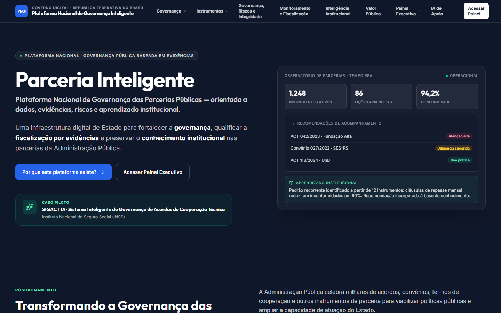
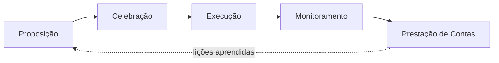
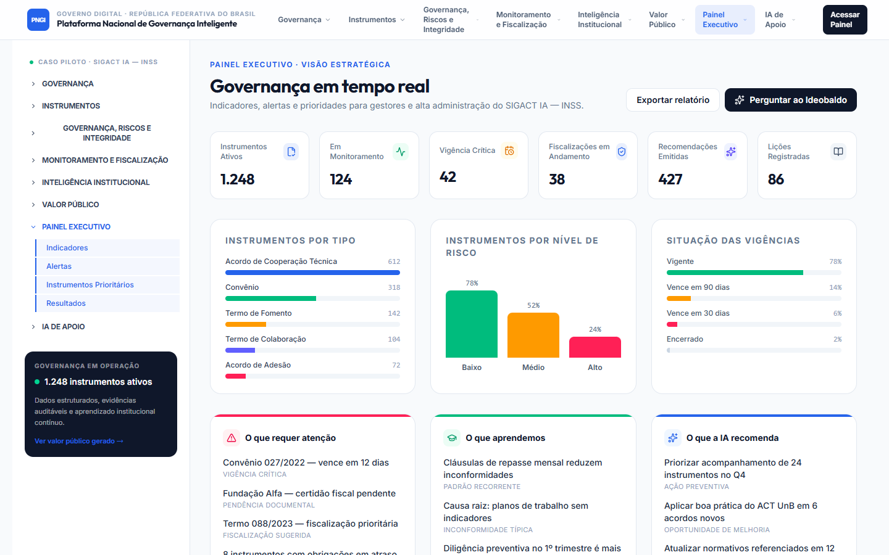
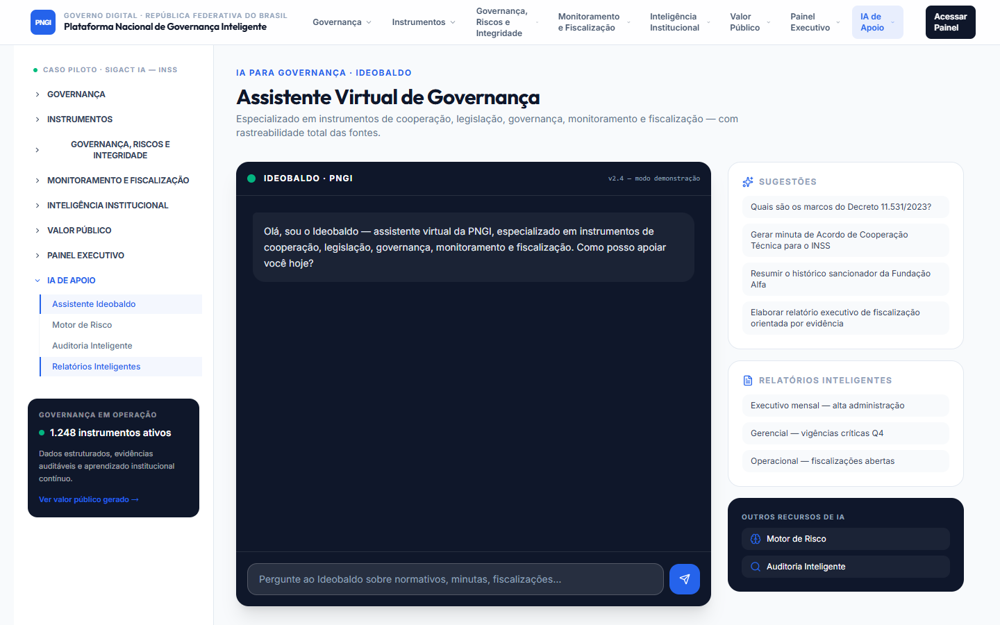

<div align="center">

# Parceria Inteligente

**Plataforma Nacional de Governança Inteligente de Instrumentos de Cooperação (PNGI)**

Governança, dados estruturados, gestão de riscos e aprendizado institucional para acordos, convênios e parcerias da Administração Pública.

[](#estágio-atual-v010-alfa)
[](CHANGELOG.md)
[](https://parceriainteligente.lovable.app)
[](#licença)


[**Ver a demo**](https://parceriainteligente.lovable.app) · [Por que existe](#a-dor) · [Como ajuda](#como-a-plataforma-ajuda) · [Rodar localmente](#como-rodar-localmente) · [Roadmap](#roadmap)

</div>

> [!IMPORTANT]
> **Versão alfa (0.1.0).** Esta é a primeira versão pública: um protótipo navegável que apresenta o modelo de governança, as telas e a experiência da plataforma. Os números e registros exibidos são **ilustrativos**. Banco de dados, login e o modelo de IA do assistente ainda serão conectados.



---

## A dor

A Administração Pública celebra milhares de acordos, convênios, termos de cooperação e outros instrumentos de parceria para viabilizar políticas públicas. A gestão dessas relações, porém, ainda depende de controles dispersos, processos manuais e conhecimento fragmentado.

| Desafio                          | O que acontece hoje                                                                                     |
| -------------------------------- | ------------------------------------------------------------------------------------------------------- |
| **Informações dispersas**        | Dados de instrumentos espalhados em planilhas, e-mails, processos e sistemas paralelos, sem integração. |
| **Controles manuais**            | Acompanhamento dependente de rotinas pontuais, sem padronização nem trilhas de auditoria nativas.       |
| **Baixa rastreabilidade**        | Dificuldade de reconstituir decisões, vigências, repasses e responsáveis ao longo do ciclo de vida.     |
| **Dificuldade de monitoramento** | Sem visão consolidada de riscos, conformidade e desempenho dos instrumentos em execução.                |
| **Perda de conhecimento**        | A saída de servidores leva embora o contexto, o raciocínio e os aprendizados que sustentavam a gestão.  |

## Como a plataforma ajuda

A proposta é sair de uma governança centrada em **documentos isolados** para uma governança centrada em **dados, evidências e aprendizado institucional**, sem substituir as competências dos servidores, mas ampliando sua capacidade de decisão.



Cada instrumento percorre cinco fases padronizadas, com marcos, evidências e responsáveis definidos. Sobre esse ciclo, a plataforma organiza seis pilares:

| Pilar                            | O que entrega                                                                                |
| -------------------------------- | -------------------------------------------------------------------------------------------- |
| 🏛️ **Governança**                | Padronização do ciclo de vida, com fases, marcos, papéis e normativos de referência.         |
| 🗂️ **Dados estruturados**        | Cadastro único de instrumentos, parceiros e vigências, com qualidade auditável.              |
| 🛡️ **Gestão de riscos**          | Indicadores de risco e integridade que orientam o acompanhamento, sem ranqueamento punitivo. |
| 📚 **Aprendizado institucional** | Lições aprendidas, boas práticas e memória organizacional preservadas e reutilizáveis.       |
| 🔎 **Transparência**             | Trilhas auditáveis e evidências acessíveis ao controle e à sociedade.                        |
| 🤖 **IA responsável**            | IA como apoio à governança e à decisão, nunca como substituta do julgamento humano.          |

**Valor para o Estado:** eficiência (menos retrabalho), transparência, continuidade administrativa apesar da rotatividade de equipes e fortalecimento da capacidade institucional.

**Caso piloto de referência:** SIGACT IA, Sistema Inteligente de Governança de Acordos de Cooperação Técnica (INSS).

## Telas

| Painel Executivo                            | Assistente Ideobaldo                               |
| ------------------------------------------- | -------------------------------------------------- |
|  |  |

| Módulo                     | Rota             | O que mostra                                           |
| -------------------------- | ---------------- | ------------------------------------------------------ |
| Página inicial             | `/`              | Proposta, pilares e arquitetura conceitual             |
| Por que existe             | `/por-que`       | O problema público e o que muda com a plataforma       |
| Painel Executivo           | `/painel`        | Indicadores, alertas e instrumentos prioritários       |
| Governança                 | `/governanca`    | Metodologia, ciclo de vida, papéis e normativos        |
| Instrumentos               | `/instrumentos`  | Cadastro único de instrumentos de cooperação           |
| Parceiros                  | `/parceiros`     | Integridade, certidões e histórico sancionador         |
| Motor de Risco             | `/risco`         | Priorização de acompanhamento por indicadores de risco |
| Auditoria Inteligente      | `/auditoria`     | Inconsistências e situações que pedem atenção          |
| Monitoramento              | `/monitoramento` | Fiscalizações, evidências e medidas corretivas         |
| Inteligência Institucional | `/inteligencia`  | Lições aprendidas, boas práticas e casos               |
| Valor Público              | `/valor-publico` | Benefícios e indicadores de resultado                  |
| Ideobaldo                  | `/ideobaldo`     | Assistente virtual de governança                       |
| Implementação              | `/implementacao` | Roadmap em seis fases                                  |

## Estágio atual (v0.1.0, alfa)

| Parte                                      | Situação                                           |
| ------------------------------------------ | -------------------------------------------------- |
| Navegação, layout e conteúdo institucional | ✅ Pronto                                          |
| Painéis, risco, auditoria, monitoramento   | 🎨 Protótipo visual com dados ilustrativos         |
| Cadastro, busca e filtros de instrumentos  | 🎨 Interface pronta, ações a implementar           |
| Ideobaldo (assistente)                     | 💬 Chat funcional na tela, modelo de IA a conectar |
| Banco de dados                             | 🔜 Próxima etapa                                   |
| Login e perfis de acesso                   | 🔜 Próxima etapa                                   |

## Stack

| Camada                       | Tecnologia                                                                                                                                                   |
| ---------------------------- | ------------------------------------------------------------------------------------------------------------------------------------------------------------ |
| Interface                    | [React 19](https://react.dev), [Tailwind CSS 4](https://tailwindcss.com), [shadcn/ui](https://ui.shadcn.com) + Radix UI, ícones [Lucide](https://lucide.dev) |
| Framework                    | [TanStack Start](https://tanstack.com/start) (renderização no servidor) + TanStack Router (rotas por arquivo)                                                |
| Linguagem                    | TypeScript (modo estrito)                                                                                                                                    |
| Build                        | [Vite 7](https://vite.dev), servidor [Nitro](https://nitro.build)                                                                                            |
| Desenvolvimento e hospedagem | [Lovable](https://lovable.dev), com publicação em [parceriainteligente.lovable.app](https://parceriainteligente.lovable.app)                                 |
| Qualidade                    | ESLint + Prettier                                                                                                                                            |

## Como rodar localmente

**Pré-requisitos:** [Git](https://git-scm.com) e [Node.js](https://nodejs.org) 20 ou superior (recomendado 22). Opcionalmente, [Bun](https://bun.sh).

```sh
git clone https://github.com/Nataliamantovani/Parcerias_inteligentes.git
cd Parcerias_inteligentes
npm install
npm run dev
```

Com Bun, use `bun install` e `bun run dev`. Não é preciso configurar variáveis de ambiente nesta versão.

| Comando           | O que faz                             |
| ----------------- | ------------------------------------- |
| `npm run dev`     | Sobe o ambiente de desenvolvimento    |
| `npm run build`   | Gera a versão de produção             |
| `npm run preview` | Serve localmente a versão de produção |
| `npm run lint`    | Verifica o código com ESLint          |
| `npm run format`  | Formata o código com Prettier         |

## Estrutura do projeto

```
src/
├── routes/        # uma tela por arquivo (o nome do arquivo define a URL)
├── components/    # layouts (InstitutionalShell, DashboardLayout) e componentes de interface
├── lib/           # dados ilustrativos (mock-data.ts) e utilitários
└── styles.css     # tema visual
docs/              # documentação técnica e imagens
```

## Roadmap

A evolução da plataforma está organizada em seis fases:

1. **Modelo metodológico nacional:** ciclo de vida, papéis, normativos e métricas institucionais.
2. **Cadastro único e governança de dados:** instrumentos, parceiros e vigências em uma base única, com integração a bases federais (CEIS, CNEP, SIORG) e aderência à LGPD.
3. **Indicadores e dashboards:** painéis executivos, gerenciais e operacionais com alertas automáticos.
4. **Motor inteligente de risco:** indicadores de risco e recomendações de acompanhamento e fiscalização.
5. **Assistente virtual de governança:** o Ideobaldo, com IA generativa e rastreabilidade de fontes.
6. **Interoperabilidade governamental:** APIs públicas e uso compartilhado entre órgãos.

Nesta versão alfa, todas as fases estão representadas na interface; a conexão com dados reais começa pelas fases 2 e 3.

## Versionamento

O projeto segue o [Versionamento Semântico](https://semver.org/lang/pt-BR/). Enquanto a versão começar com `0.`, a plataforma está em fase alfa e pode mudar bastante entre versões. Cada versão publicada recebe uma tag no Git (`v0.1.0`, `v0.2.0`…) e é descrita no [CHANGELOG](CHANGELOG.md).

## Mantenedora

<!-- Natalia: complete as duas lacunas abaixo, depois faça commit e push da mudança. -->

**Natalia `[SOBRENOME]`**, `[FORMAÇÃO — curso e instituição]`, desenvolve o projeto de forma independente, movida pelo interesse em transparência e na melhoria da gestão pública.

[](https://github.com/Nataliamantovani)

Sugestões e dúvidas são bem-vindas pelas [issues](https://github.com/Nataliamantovani/Parcerias_inteligentes/issues) do repositório.

## Licença

Ainda não definida. Até a escolha de uma licença, todos os direitos estão reservados à autora.
